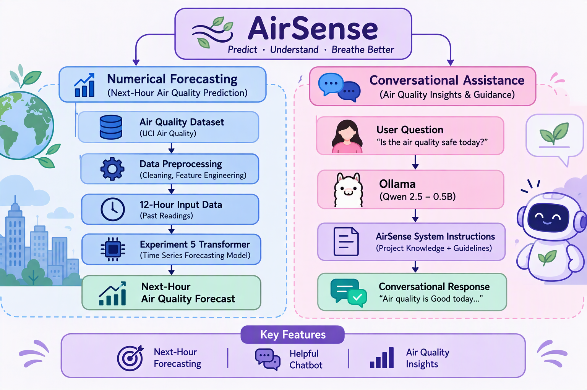

# 🌿 AirSense: Air Quality Forecasting and Conversational Assistance

**Predict · Understand · Breathe Better**

AirSense is an AI-based academic project that combines numerical air quality forecasting with conversational assistance. It aims to help users understand air quality data, explore future predictions, and access air-quality-related information through chatbot demonstrations.

## 📌 Project Overview

AirSense consists of two main components:

1. **Numerical Forecasting:** A Transformer-based time-series model that uses historical air quality readings to predict the next hour's values.
2. **Conversational Assistance:** A rule-based chatbot in the Streamlit application, alongside a separate Qwen 2.5 (0.5B) chatbot demonstration using Ollama.

These components currently operate separately.

## 🏗️ System Architecture



## ⚙️ Technologies Used

- Python
- PyTorch
- Pandas
- NumPy
- Matplotlib
- Scikit-learn
- Streamlit
- Jupyter Notebook
- Ollama
- Qwen 2.5 (0.5B)
- Hugging Face
- Git

## 🧠 Component 1: Numerical Forecasting

The forecasting component uses a Transformer-based neural network trained on historical air quality data.

### Workflow

1. Collect historical air quality data.
2. Perform data cleaning and preprocessing.
3. Normalize the selected features.
4. Prepare 12-hour input sequences.
5. Train the Experiment 5 Transformer model.
6. Generate next-hour air quality predictions.

### Experiment 5 Details

| Parameter | Details |
|---|---|
| Model | Transformer |
| Input sequence | 12 hours |
| Selected features | 9 |
| Output | Next-hour predictions |
| Framework | PyTorch |
| Parameters | 110,857 |

The trained model is saved as a PyTorch checkpoint (`.pt`).

## 💬 Component 2: Conversational Assistance

AirSense includes two conversational implementations:

**1. Streamlit Chatbot**

The main Streamlit application (`app.py`) includes a simple rule-based chatbot that responds to air-quality-related keywords.

**2. Ollama Chatbot Demonstration**

A separate chatbot demonstration uses the Qwen 2.5 (0.5B) model through Ollama. A customized Modelfile provides AirSense-specific system instructions to guide its responses.

**Important:** The Qwen model is an existing pretrained model with customized instructions. It has not been fine-tuned on the AirSense numerical forecasting dataset.

## 📊 Model Evaluation

The numerical forecasting model was evaluated using:

- Mean Absolute Error (MAE)
- Mean Squared Error (MSE)
- Root Mean Squared Error (RMSE)

Experiment 5 was compared with earlier experiments and a persistence baseline using the same nine selected features.

The results showed improvements in MSE and RMSE compared with the persistence baseline, while the baseline achieved a lower MAE.

This indicates that further model optimization is required.

## ⚠️ Limitations

- The forecasting model's performance is not consistently better than the persistence baseline across all evaluation metrics.
- The numerical forecasting and conversational components operate separately.
- The Qwen chatbot is not fine-tuned on the AirSense numerical forecasting dataset.
- Predictions depend on the quality and availability of input data.
- The project is an experimental academic implementation and should not be used as a substitute for official air quality monitoring information.

## 📁 Project Structure

```text
AirSense/
│
├── README.md
├── requirements.txt
├── .gitignore
├── app.py
├── Modelfile
├── airsense_input_template.csv
│
├── app/
│
├── data/
│   ├── raw/
│   └── processed/
│
├── docs